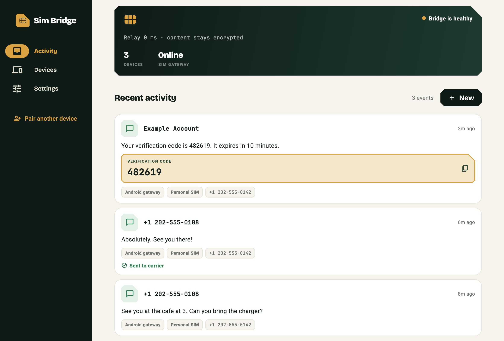

<p align="center"></p>

<h1 align="center">Sim Bridge</h1>

<p align="center">
  The SMS messages of your Android phone on your iPhone, Mac, Windows PC and Linux desktop,<br>
  end-to-end encrypted, through a relay you run yourself.
</p>

<p align="center">
  <a href="https://sim-bridge.renner.dev">Website</a> ·
  <a href="https://github.com/rennerdo30/sim-bridge/releases/latest">Download</a> ·
  <a href="https://sim-bridge.renner.dev/docs/">Documentation</a> ·
  <a href="https://github.com/rennerdo30/sim-bridge/issues">Issues</a> ·
  <a href="LICENSE">MIT license</a>
</p>



## What it does

One Android phone with an active SIM becomes the **gateway**. Every other device joins it as a
**client**:

- read incoming SMS on all paired devices, with verification codes detected and shown large;
- send SMS through the gateway, choosing the SIM on dual-SIM phones, and see the carrier result;
- start calls on the gateway phone from another device and see incoming and ongoing calls (call audio stays on Android);
- pair with a QR code on phones, or a 52-character recovery code on any device;
- use it in English or German.

| Platform | Role | Background behaviour |
| --- | --- | --- |
| Android | Gateway or client | The gateway runs as a foreground service and survives reboots |
| iOS / iPadOS | Client | Encrypted push previews through the notification extension |
| macOS, Windows, Linux | Client | Live sync while the app runs, including minimized |

## How it works

```
  Android gateway  ──┐                         ┌──  iPhone
  (SIM, SMS, calls)  ├──  relay (ciphertext) ──┤    Mac / Windows / Linux
                     │   memory only, no disk  │    other Android phones
```

Everything that leaves a device is sealed with **AES-256-GCM** under a 256-bit bridge key that is
created on the gateway and shared only by QR code or recovery code. The relay forwards ciphertext,
keeps it in memory for at most five minutes and writes nothing to disk. It never receives the key,
message text, phone numbers or SIM details. Commands are bound to one bridge, sender and gateway
and are refused if they are replayed or arrive late. Clients sync through an authenticated event
stream; there is no periodic polling.

The relay still sees routing metadata: device names, IP addresses, message sizes and timing.
Read the [security model](https://sim-bridge.renner.dev/docs/guides/security/) for the details
and limits.

## Get started

### 1. Run a relay

There is no Sim Bridge service: you run your own relay. The easiest option is **Cloudflare Workers**,
free for a personal bridge, with no server to maintain; the relay keeps all state in memory.

[](https://deploy.workers.cloudflare.com/?url=https://github.com/rennerdo30/sim-bridge/tree/main/server)

When asked for `SIM_BRIDGE_ACCESS_KEY`, enter a new random secret of 32+ characters: your owner
key. Or deploy from the command line:

```sh
git clone https://github.com/rennerdo30/sim-bridge.git
cd sim-bridge/server
npm ci
npx wrangler login
npx wrangler secret put SIM_BRIDGE_ACCESS_KEY   # a new random secret, 32+ characters
npm run deploy:worker
```

You can also run the relay with Node.js 22 on your own machine or server, or in Docker behind
a tunnel. See [server/README.md](server/README.md).

### 2. Install the apps

- **Desktop:** download the macOS, Windows or Linux package from the
  [latest release](https://github.com/rennerdo30/sim-bridge/releases/latest).
- **Android and iOS:** build from source for now (see below); store releases are in preparation.

### 3. Pair

On the Android phone, create a bridge with your relay URL and the owner key, and grant the
SMS and phone permissions. On every other device, scan the QR code or enter the relay URL and the
recovery code. Keep the recovery code private: it is the bridge key.

## Build from source

Requirements: Flutter 3.38.6, Node.js 22 and the native toolchain for your target platform.

```sh
cd app
flutter pub get --enforce-lockfile
flutter run -d macos        # or windows, linux, an Android or iOS device

cd ../server
npm ci
SIM_BRIDGE_ACCESS_KEY='a-local-development-secret' npm start
```

Checks:

```sh
cd app && flutter analyze && flutter test
cd server && npm test && npm run test:wasm && npm run test:worker
```

Native desktop packaging is described in [app/README.md](app/README.md), releases in
[RELEASING.md](RELEASING.md), and the pairing recovery design in
[PAIRING-RECOVERY-PROTOCOL.md](PAIRING-RECOVERY-PROTOCOL.md).

## Good to know

- Sim Bridge needs an Android phone as the gateway. iPhones and computers cannot use a SIM directly,
  and Sim Bridge does not place messages inside Apple Messages.
- It is not an emergency calling service.
- Messages sent through the gateway use your carrier plan.
- Desktop packages are not notarized or code-signed by a publisher yet; your OS may warn on first
  launch.

## Contributing and security

Contributions are welcome; start with [CONTRIBUTING.md](CONTRIBUTING.md). Report security issues
privately as described in [SECURITY.md](SECURITY.md).

## License

Sim Bridge is released under the [MIT license](LICENSE). The bundled Bricolage Grotesque and
JetBrains Mono fonts are under the SIL Open Font License; their notices are in `app/assets/fonts`
and `server/public/fonts`.
